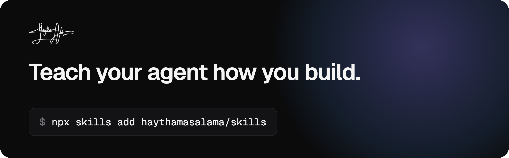

<p align="center">
  <a href="https://skills.haythamasalama.me">
    
  </a>
</p>

<h1 align="center">Claude Code Skills</h1>

<p align="center">
  Agent skills for Claude Code, Cursor, Codex and other coding agents.<br>
  Laravel DDD, Inertia + Vue, Nuxt UI, shadcn-vue, Apple iOS 27 and macOS 27 design, and more.
</p>

<p align="center">
  <a href="#skills"></a>
  <a href="#recommended-skills"></a>
  <a href="LICENSE"></a>
  <a href="#contributing"></a>
  <a href="https://skills.sh"></a>
</p>

<p align="center">
  <a href="https://skills.haythamasalama.me"><b>Website</b></a> ·
  <a href="#quick-start"><b>Quick start</b></a> ·
  <a href="#skills"><b>Skills</b></a> ·
  <a href="#recommended-skills"><b>Recommended</b></a> ·
  <a href="#contributing"><b>Contributing</b></a>
</p>

## Quick start

```bash
# Pick from a list
npx skills add haythamasalama/skills

# Install one
npx skills add haythamasalama/skills --skill laravel-ddd

# Install several at once
npx skills add haythamasalama/skills --skill laravel-ddd laravel-code-quality nuxt-ui-kit
```

Run it in your project folder, and add `-g` to install for every project. You can also search the
[website](https://skills.haythamasalama.me), tick the skills you want, and copy one command.

## What is a skill?

A skill is a folder with a `SKILL.md`. Your agent reads its description, loads it when a task matches, and
follows it. Longer details sit in `references/` and load only when needed.

```text
skills/laravel-ddd/
├── SKILL.md        when to use it, and the rules that matter most
└── references/     one file per topic, read when needed
```

How the skills here are written:

- **Each one stands alone.** Install one without the others; no skill depends on another.
- **Concrete, not advice.** Folder trees, day-one files, components and exact design values, so a new project
  starts the same way every time.
- **Generic.** Examples use plain users and employees, so they fit any project.

## Skills

### Backend

| Skill | What it gives your agent |
|---|---|
| [laravel-ddd](skills/laravel-ddd) | A Domain-Driven Design layout for Laravel: Actions, DTOs, Contracts, Services, controllers, JSON API, tests |
| [laravel-code-quality](skills/laravel-code-quality) | Code style, security, sensitive operations, the anti-pattern catalogue and code review |

### Frontend

| Skill | What it gives your agent |
|---|---|
| [laravel-inertia-vue](skills/laravel-inertia-vue) | A Laravel + Inertia + Vue 3 front-end blueprint: folders, day-one files, house components, forms, lists, theme, RTL |
| [nuxt-ui-kit](skills/nuxt-ui-kit) | A Nuxt UI 4 blueprint with a copy-ready theme, dashboard shell, i18n and RTL, static sites and SEO |
| [shadcn-vue-kit](skills/shadcn-vue-kit) | shadcn-vue setup with a ready theme, the component catalogue, wrappers, charts and RTL fixes |

### Design

| Skill | What it gives your agent |
|---|---|
| [apple-ios-27-design](skills/apple-ios-27-design) | Exact iOS 27 sizes, colours, type and Liquid Glass values from Apple's UI Kit |
| [apple-macos-27-design](skills/apple-macos-27-design) | Exact macOS 27 sizes, colours, type and Liquid Glass values from Apple's UI Kit |
| [apple-screens](skills/apple-screens) | Mac window and iPhone screen mockups drawn as HTML and rendered to PNG |
| [liquid-glass-web](skills/liquid-glass-web) | Apple-style Liquid Glass CSS for websites and landing pages |
| [haythamasalama-brand](skills/haythamasalama-brand) | The author's personal brand: signature, colours, type and voice |

### DevOps

| Skill | What it gives your agent |
|---|---|
| [coolify-deploy](skills/coolify-deploy) | Dockerfiles, nginx and Coolify settings for SPA, prerendered and server apps |
| [git-workflow](skills/git-workflow) | Git commit messages with Conventional Commits, branch names, pull requests and merging |

### Integrations

| Skill | What it gives your agent |
|---|---|
| [whatsapp-business-manager](skills/whatsapp-business-manager) | What Meta's WhatsApp Cloud API can do: webhooks, message templates, limits and pricing |

## Recommended skills

Skills by other people that work well with these. Each one belongs to its author; this repo only lists them
in [skills-lock.json](skills-lock.json) and never copies them. Skills that need a paid service or a sign-in are
left out.

<details>
<summary><b>Laravel</b> (3)</summary>

| Skill | What it does | Source |
|---|---|---|
| [laravel-best-practices](https://github.com/laravel/boost/tree/HEAD/.ai/laravel/skill/laravel-best-practices) | Laravel's own best-practice rules for PHP code. | laravel/boost |
| [laravel-database-optimization](https://github.com/asyrafhussin/agent-skills/tree/HEAD/skills/laravel-database-optimization) | Fast Laravel queries, indexes, caching and migrations. | asyrafhussin/agent-skills |
| [laravel-verification](https://github.com/affaan-m/ecc/tree/HEAD/skills/laravel-verification) | A pre-PR and pre-deploy check loop for Laravel projects. | affaan-m/ecc |

</details>

<details>
<summary><b>Vue and Nuxt</b> (5)</summary>

| Skill | What it does | Source |
|---|---|---|
| [nuxt-ui](https://ui.nuxt.com/) | Build UIs with Nuxt UI v4 components and Tailwind theming. | ui.nuxt.com |
| [shadcn-vue](https://github.com/unovue/shadcn-vue/tree/HEAD/skills/shadcn-vue) | Add, fix, style and compose shadcn-vue components with project context. | unovue/shadcn-vue |
| [vue-best-practices](https://github.com/vuejs-ai/skills/tree/HEAD/skills/vue-best-practices) | Vue 3 with the Composition API, script setup and TypeScript. | vuejs-ai/skills |
| [vue-pinia-best-practices](https://github.com/vuejs-ai/skills/tree/HEAD/skills/vue-pinia-best-practices) | Pinia stores, state patterns and reactivity. | vuejs-ai/skills |
| [vue-testing-best-practices](https://github.com/vuejs-ai/skills/tree/HEAD/skills/vue-testing-best-practices) | Vue testing with Vitest, Test Utils and Playwright. | vuejs-ai/skills |

</details>

<details>
<summary><b>Design and motion</b> (16)</summary>

| Skill | What it does | Source |
|---|---|---|
| [animate](https://github.com/emilkowalski/skills/tree/HEAD/skills/animate) | Build an animation from scratch, deciding purpose, tool, curve and duration. | emilkowalski/skills |
| [animate-expo](https://github.com/emilkowalski/skills/tree/HEAD/skills/animate-expo) | Animations in React Native and Expo that feel right on the device. | emilkowalski/skills |
| [animation-vocabulary](https://github.com/emilkowalski/skills/tree/HEAD/skills/animation-vocabulary) | Find the exact name for a motion effect you can only describe. | emilkowalski/skills |
| [apple-design](https://github.com/dickwu/apple-design-skill) | UI and UX review grounded in Apple's Human Interface Guidelines. | dickwu/apple-design-skill |
| [ask-sonner](https://github.com/emilkowalski/skills/tree/HEAD/skills/ask-sonner) | Guide to Sonner, the React toast library. | emilkowalski/skills |
| [design-taste-frontend](https://github.com/Leonxlnx/taste-skill/tree/HEAD/skills/taste-skill) | Art direction for websites, distilled from 247 curated gallery sites. | Leonxlnx/taste-skill |
| [emil-design-eng](https://github.com/emilkowalski/skills/tree/HEAD/skills/emil-design-eng) | Emil Kowalski's approach to UI polish, components and animation. | emilkowalski/skills |
| [find-animation-opportunities](https://github.com/emilkowalski/skills/tree/HEAD/skills/find-animation-opportunities) | Find places in a UI that should animate, and reject those that shouldn't. | emilkowalski/skills |
| [frontend-design](https://github.com/anthropics/skills/tree/HEAD/skills/frontend-design) | Distinctive, intentional visual design for new or reshaped UI. | anthropics/skills |
| [impeccable](https://github.com/pbakaus/impeccable/tree/HEAD/.agents/skills/impeccable) | Design, critique, polish and audit any front-end interface. | pbakaus/impeccable |
| [improve-animations](https://github.com/emilkowalski/skills/tree/HEAD/skills/improve-animations) | Audit the motion in a codebase and plan the fixes. | emilkowalski/skills |
| [mobile-native](https://github.com/emilkowalski/skills/tree/HEAD/skills/mobile-native) | Make a web app feel native on a phone. | emilkowalski/skills |
| [pick-ui-library](https://github.com/emilkowalski/skills/tree/HEAD/skills/pick-ui-library) | Pick the right front-end library for a task from a curated list. | emilkowalski/skills |
| [prototype](https://github.com/emilkowalski/skills/tree/HEAD/skills/prototype) | Build several versions of a UI piece and flip between them live. | emilkowalski/skills |
| [review-animations](https://github.com/emilkowalski/skills/tree/HEAD/skills/review-animations) | Review animation code against a high craft bar. | emilkowalski/skills |
| [write-swift](https://github.com/emilkowalski/skills/tree/HEAD/skills/write-swift) | Modern Swift: value types, Swift 6 concurrency and data-race safety. | emilkowalski/skills |

</details>

<details>
<summary><b>AI and agents</b> (15)</summary>

| Skill | What it does | Source |
|---|---|---|
| [agent-browser](https://github.com/vercel-labs/agent-browser/tree/HEAD/skills/agent-browser) | Browser automation CLI for AI agents: navigate, fill forms, click, screenshot. | vercel-labs/agent-browser |
| [cavecrew](https://github.com/JuliusBrussee/caveman/tree/HEAD/skills/cavecrew) | When to hand work to small, terse investigator, builder and reviewer agents. | JuliusBrussee/caveman |
| [caveman](https://github.com/JuliusBrussee/caveman/tree/HEAD/skills/caveman) | A terse answering style that keeps every technical fact and cuts the fluff. | JuliusBrussee/caveman |
| [caveman-compress](https://github.com/JuliusBrussee/caveman/tree/HEAD/skills/caveman-compress) | Compress memory files like CLAUDE.md to save input tokens. | JuliusBrussee/caveman |
| [caveman-explore](https://github.com/JuliusBrussee/caveman/tree/HEAD/skills/caveman-explore) | A read-only repository explorer that returns compact file and line citations. | JuliusBrussee/caveman |
| [caveman-help](https://github.com/JuliusBrussee/caveman/tree/HEAD/skills/caveman-help) | Quick reference for the caveman skills and commands. | JuliusBrussee/caveman |
| [caveman-review](https://github.com/JuliusBrussee/caveman/tree/HEAD/skills/caveman-review) | Code review with one line per finding: location, problem, fix. | JuliusBrussee/caveman |
| [find-skills](https://github.com/vercel-labs/skills/tree/HEAD/skills/find-skills) | Discover and install agent skills for a task. | vercel-labs/skills |
| [grill-me](https://github.com/mattpocock/skills/tree/HEAD/skills/productivity/grill-me) | A /grill-me command that starts the grilling interview. | mattpocock/skills |
| [grilling](https://github.com/mattpocock/skills/tree/HEAD/skills/productivity/grilling) | Stress-test a plan or idea with relentless questions. | mattpocock/skills |
| [lean-build](https://github.com/JuliusBrussee/caveman/tree/HEAD/skills/lean-build) | Build features with strict scope and an explicit stop condition. | JuliusBrussee/caveman |
| [migration](https://github.com/JuliusBrussee/caveman/tree/HEAD/skills/migration) | Reversible, compatibility-safe migrations with a rollback path. | JuliusBrussee/caveman |
| [safe-refactor](https://github.com/JuliusBrussee/caveman/tree/HEAD/skills/safe-refactor) | Restructure code while keeping its behaviour. | JuliusBrussee/caveman |
| [teach](https://github.com/mattpocock/skills/tree/HEAD/skills/productivity/teach) | Learn a new skill or concept inside your workspace. | mattpocock/skills |
| [verify-and-stop](https://github.com/JuliusBrussee/caveman/tree/HEAD/skills/verify-and-stop) | Prove work meets its acceptance checks without widening scope. | JuliusBrussee/caveman |

</details>

<details>
<summary><b>Security</b> (1)</summary>

| Skill | What it does | Source |
|---|---|---|
| [security-audit](https://github.com/cloudflare/security-audit-skill/tree/HEAD/skills/security-audit) | Security guidance and vulnerability review for code and services. | cloudflare/security-audit-skill |

</details>

To install all 40, copy [skills-lock.json](skills-lock.json) into your project root and run:

```bash
npx skills experimental_install
```

Laravel's own Boost package adds more Laravel skills and an MCP server:
`composer require laravel/boost --dev && php artisan boost:install`.

## Contributing

Contributions are welcome.

- **Suggest a skill or report a mistake:** [open an issue](https://github.com/haythamasalama/skills/issues/new).
- **Fix or improve a skill:** open a pull request. [CONVENTIONS.md](CONVENTIONS.md) explains how a skill is
  structured.

Before opening a pull request, run the checks. To preview the website locally, run `site.sh`:

```bash
sh scripts/check.sh
sh scripts/privacy-scan.sh
sh scripts/site.sh     # http://localhost:4321
```

## License

[MIT](LICENSE). The license does not cover the name, signature and logos in `skills/haythamasalama-brand/` and
`site/public/logos/`, or the third-party trademarks mentioned in the skills.

---

<p align="center">
  Made by <a href="https://haythamasalama.me">Haytham A. Salama</a>. If a skill saves you time, a star helps others find it.
</p>
